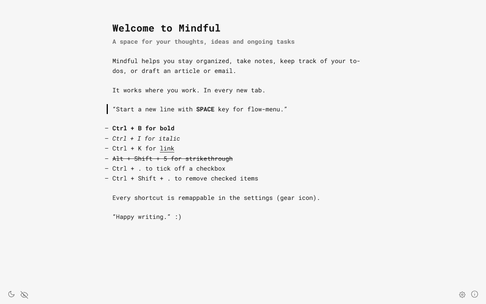
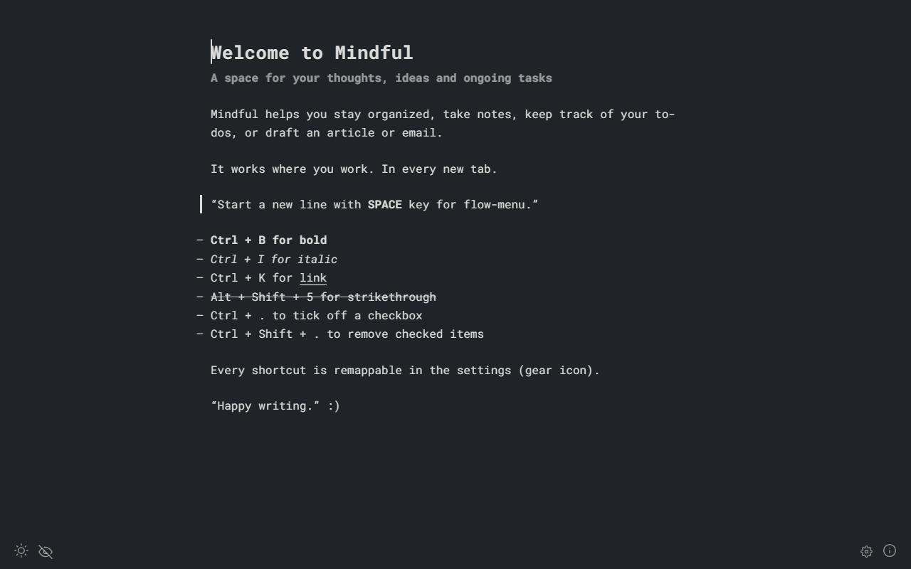
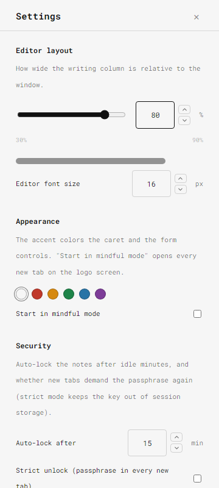
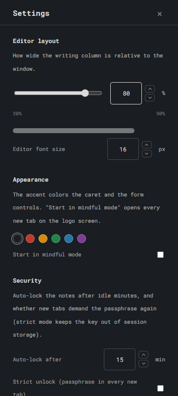
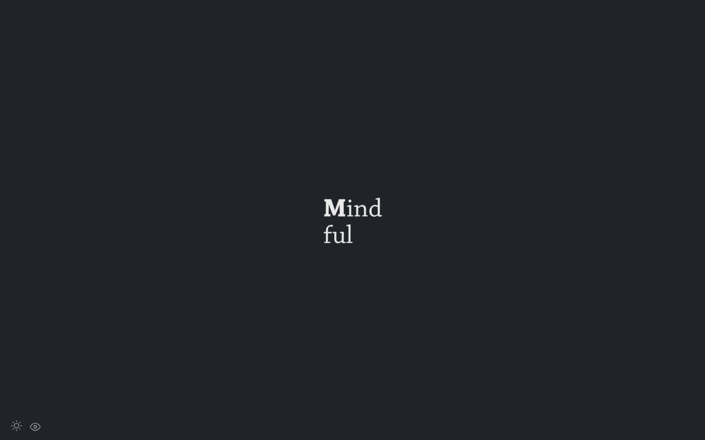

<p align="center">
  <picture>
    <source media="(prefers-color-scheme: dark)" srcset="assets/mindful-dark.png">
    
  </picture>
</p>

<h1 align="center">Mindful (Next)</h1>

<p align="center">A minimal, private writing space in every new tab.<br>
An encrypted notepad for Chrome — thoughts in, world out.</p>

---

A new-tab Chrome extension (MV3): a minimal, private writing space in every
new tab. It is the continuation of Mindful (Beta) — the 2016 original by
Adrian Zumbrunnen — rebuilt from its source map into a fully readable,
CSP-compliant codebase. Everything is readable; `dist/` is what Chrome loads.

<p align="center">
  
  
</p>
<p align="center">
  
  
</p>
<p align="center">
  
</p>

## Features

- **Encrypted notes** — AES-256-GCM via Web Crypto with non-extractable
  keys, PBKDF2 (310k iterations); nothing ever persists in plaintext.
  Encrypted sync replication, daily snapshots, rollback protection,
  auto-lock, cross-tab lock broadcast. Optional strict unlock demands the
  passphrase on every new tab. Full model in [SECURITY.md](SECURITY.md).
- **Settings drawer** (gear icon) — editor column width, font size,
  accent color, auto-lock minutes, sync on/off + interval, notes
  export/import, shortcut remapping, settings export/import.
- **Remappable shortcuts** — every editor command's binding can be
  remapped; Chrome-reserved combos and duplicates are rejected; overrides
  persist.
- **Notes export / import** — one-click Markdown/HTML export; sanitized
  `.md` / `.html` import.
- **Smooth caret** — a Word-style caret with an eased glide, soft
  accent glow, gentle breathe and a ripple on every keystroke (honors
  reduced motion).
- **Day / night / mindful mode** — hide the editor, keep the logo.
- **Runs on modern Chrome** — Manifest V3, `script-src 'self'` CSP with
  zero `eval`/`new Function`; no frameworks.
- **Tested** — a 75-check Playwright suite (editor smoke, caret, settings,
  vault encryption sweep, shortcuts).

## Install

`chrome://extensions` → Developer mode → **Load unpacked** → select
the `dist` folder inside your clone — **the `dist` folder, not the repo root** (the
root has no bundle; a red on-page badge will tell you if you got it wrong).

## Development

```bash
npm install          # esbuild + playwright (devDependencies only)
npm run build        # -> dist/  (npm run watch rebuilds on change)
npm test             # 75 checks: editor smoke + caret, settings, vault,
                     # shortcuts suites
```

The smoke suite runs its checklist against `dist/index.html` (rebuilt) and,
when the private `legacy/` fixture is present next to the repo, also against
`legacy/index-legacy.html` (original 2016 bundle) for A/B parity — that leg
is skipped when the fixture is absent. `scripts/debug/*.js` are
real-extension probes (load dist with Playwright, click things, report
state).

### Repository layout

```
index.html, manifest.json   canonical page + manifest (copied into dist/)
assets/                     icons, favicons, fonts, logo
styles/                     m.css, fonts.css, caret.css
runtime/                    mv3-fixes.js, caret-smooth.js (hand-maintained scripts)
src/                        the recovered source tree (app + vendor + shims)
  src/mindful/index.js      bundle entry point
  src/MANIFEST.json         provenance map: webpack:/// source -> file
legacy/                     optional private fixture (2016 bundle + map + A/B
                            harness) — NOT part of this repo; the suite skips
                            it when absent. extract-sources.py needs its map.
scripts/                    build.js, extract-sources.py, debug/ probes
tests/                      Playwright suites: editor smoke + caret, settings,
                            vault, shortcuts
dist/                       generated output — Load unpacked THIS folder
```

## Security

Notes are never persisted in plaintext — anywhere. The full security
model (ciphers, key lifetime, threat coverage, honest limitations) lives
in [SECURITY.md](SECURITY.md).

## Credits & provenance

**Mindful was created by [Adrian Zumbrunnen](https://twitter.com/azumbrunnen_)**
while he was at the Swiss digital agency **[Hinderling Volkart](http://www.hinderlingvolkart.com)** —
it launched in December 2016 and reached #1 on
[Product Hunt](https://www.producthunt.com/products/mindful-chrome-extension).
The original in-product credits are preserved verbatim in this rebuild: the
"Created by @azumbrunnen_" line and the Hinderling Volkart link in the
editor's demo content.

This repository is a **personal-use reconstruction** of that 2016 bundle
(store id `cieekmjjdkckhpidgaffphlaljdfhhab`, since removed from the Chrome
Web Store). No open-source license was shipped with the original package —
all rights to the original design and code remain with Adrian Zumbrunnen
and Hinderling Volkart. The changes here (MV3 migration, CSP-safe rebuild,
bug fixes) exist to keep a beloved tool alive on modern Chrome.

## License & attribution

- **Original Mindful design & code** — © [Adrian Zumbrunnen](https://twitter.com/azumbrunnen_)
  and [Hinderling Volkart](http://www.hinderlingvolkart.com), **all rights
  reserved**. The 2016 package shipped no license; nothing in this
  repository grants rights over it. The recovered sources, the original
  icon font files (`src/src/core/ui/res/frontkit.*`) and the original
  assets are redistributed here **for personal, non-commercial use only**,
  in order to keep a dead tool working on modern Chrome.
- **This rebuild's own additions** — the encrypted vault, settings panel,
  shortcut remapping, caret overlay, MV3 tooling, tests and docs — are
  shared under the same terms: personal, non-commercial, educational use;
  attribution appreciated; no warranty.
- **Rights holders**: if you hold rights to the original work and object
  to this repository, open an issue and it will be taken down promptly.
  A friendly word from the original authors would also be very welcome.
- **Third-party components** — recovered from the bundle and re-attributed
  in [NOTICE](NOTICE): lodash (MIT), ms (MIT), lz-string (WTFPL v2),
  Roboto Mono (Apache 2.0).

## History in one paragraph

The 2016 original was a webpack-1 minified bundle (`legacy/m.legacy.js`)
whose source map carried all 387 original files. This repo extracted them
(`scripts/extract-sources.py`), made the bundle MV3/CSP-compliant (no
`new Function`/eval anywhere — the original's Vue 1.x bubble component was
rewritten as a plain-DOM module), fixed a series
of latent bugs, and put the whole thing under test. See `docs/MIGRATION_NOTES.md`
and the git log for the full story.
